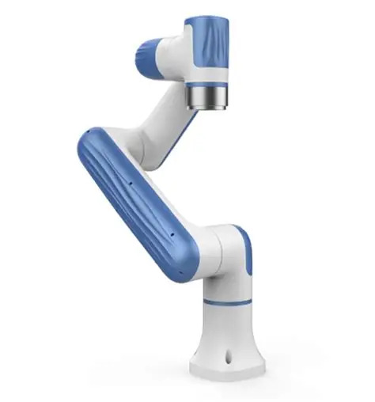

# Dobot Nova2 · Robonix Deployment

English | [简体中文](README.md)

Use `rbnx chat` to read the Nova2's six joint positions, control the TG-9801 gripper, and pick and place objects at a calibrated height using an Orbbec camera. The arm connects over TCP/IP, the gripper uses a host USB-to-RS485 adapter, and the camera uses the Orbbec SDK. The deployment runs without ROS 2 or Docker.



## 1. Set up the environment

This deployment was tested on Ubuntu 22.04 x86-64 under WSL2 with Robonix `1.1.0-beta.1` and Nova2 firmware `3.5.8.5` using the Dobot V3 protocol. The gripper and camera drivers also support native Linux connections.

Install [Robonix](https://github.com/syswonder/robonix/tree/v1.1.0-beta.1) and [uv](https://docs.astral.sh/uv/getting-started/installation/). If you already have the Robonix CLI and source tree, start with the environment checks below. To build Robonix from source, first put Rust, Cargo, and uv on your PATH, then run the following commands.

```bash
sudo apt install build-essential pkg-config libssl-dev git curl libasound2-dev
git clone --recursive --branch v1.1.0-beta.1 https://github.com/syswonder/robonix.git
cd robonix
make install
```

Make sure `rbnx`, `robonix-codegen`, and the Robonix system executables are on your PATH. If Robonix cannot find its source tree, run `rbnx setup "$PWD"` from the Robonix source directory.

```bash
rbnx --version
rbnx path robonix-api
uv python install 3.11
```

## 2. Connect and configure the hardware

```bash
git clone https://github.com/syswonder/robot-dobot-nova2.git
cd robot-dobot-nova2
cp .env.example .env
```

Set `VLM_BASE_URL`, `VLM_API_KEY`, and `VLM_MODEL` in `.env`. Use the base URL of an OpenAI-compatible API, such as `https://your-model-provider.example/v1`. Visual grasping uses the same settings by default and requires a model that accepts images. The skill sends the current camera image to the configured endpoint.

Edit [robonix_manifest.yaml](robonix_manifest.yaml) to match your hardware.

| Instance | What to check |
| --- | --- |
| `nova2_arm` | Put the controller in TCP/IP mode. Set the host Ethernet adapter to the same subnet, for example `192.168.5.100/24`. The controller defaults to `192.168.5.1` and must also be reachable from WSL. The V3 connection uses ports 29999, 30003, and 30004. |
| `tg9801_gripper` | Check the USB-to-RS485 port, device address, and baud rate. The supplied settings use Modbus RTU, 115200 baud, and device ID 1, with `windows_port: COM3` under WSL. On native Linux, set `windows_port` to `""`, set `port` to the actual serial device, and give your user access to it. |
| `orbbec_camera` | The supplied settings use a Gemini 336L with a 1280×720 MJPG color stream at 10 fps. Check `serial_number`, the stream settings, and `expected_camera_key`. If only one camera is connected, you can leave `serial_number` empty and let the SDK select it. Close any calibration software or Orbbec Viewer instance using the camera before boot. |
| `nova2_grasp` | For a new workcell, update the calibration, ready pose, drop-off locations, and jaw alignment as described below. |

Under WSL2, connect the camera to Windows over USB and the gripper to a Windows COM port through the RS485 adapter. The build script prepares a dedicated Windows SDK environment in `%LOCALAPPDATA%\Robonix-Nova2-Orbbec`. Make sure WSL can find `powershell.exe`. On native Linux, the SDK runs in the package's Python environment. Install the Orbbec USB permission rules for your device. See the configuration reference for the [arm](primitives/nova2_arm/config.spec), [gripper](primitives/tg9801_gripper/config.spec), [camera](primitives/orbbec_camera/config.spec), and [grasp skill](skills/nova2_grasp/config.spec).

### Configure grasping for a new workcell

The values in `config/grasp/` come from the original workcell. Repeat the relevant calibration or teaching steps after changing the camera, mount position, tool, table height, or robot.

- [calibration.json](config/grasp/calibration.json) is a `nova2-planar-handeye-v1` export. It stores the undistorted image's `camera_key`, the mapping from pixels to User0 XY, the valid sampling polygon, and the grasp height `z_mm` measured at the first sample. After exporting a new calibration, set the camera's `expected_camera_key` to the exported value. Stop the deployment before running the separate calibration program. Exit that program after exporting the file, then boot the deployment again.
- [ready_pose.json](config/grasp/ready_pose.json) stores the taught ready pose. With User0/Tool0 selected, record the six joint angles and tool pose from the same arm state in `joints_deg` and `pose_mm_deg`, respectively. The ready pose Z must be at least `z_mm + approach_height_mm`.
- [runtime.json](config/grasp/runtime.json) stores the jaw closing axis offset and its confirmation state. These settings take precedence over the deployment manifest. After replacing or reinstalling the gripper, set `confirmed` to `false`. Verify jaw alignment above the target, then use `set_jaw_alignment` to save and confirm the offset.
- [place_locations.json](config/grasp/place_locations.json) maps location names to `xy_mm` in User0 and `release_height_mm` above the calibrated `z_mm`. The white box example is named `白盒子` and releases 150 mm above the calibrated plane.

For basic control, you can remove the `nova2_grasp` entry from the manifest's `skill` section. If you do not have a camera, also remove the camera primitive and the `camera` component in `soma.yaml`. Set the hover height, motion speed, and JSON paths in the `config` block for `nova2_grasp`. Restart the deployment after editing those settings.

## 3. Boot and use the deployment

```bash
./scripts/boot.sh
```

The script reads the repository's `.env` and starts Atlas, Executor, Soma, Pilot, Liaison, and the packages listed in the manifest. The first boot builds any missing packages. You can also run `rbnx build -f robonix_manifest.yaml` to verify the build ahead of time, or run `rbnx boot` directly from a shell where the model variables are already exported.

Wait for the arm, gripper, and camera to report `ACTIVE`. The skill activates on demand and may initially report `INACTIVE`. On startup, the drivers connect to the hardware and read feedback. Open a second terminal and run the following commands.

```bash
rbnx caps -v
rbnx tools
rbnx chat
```

Start with prompts that check the available capabilities and current state.

> Read the arm, gripper, and camera states and report the feedback only.

> Use `nova2_grasp`'s `plan_grasp` to plan a grasp for the green block. Report the annotated image and inverse kinematics results.

Once you have verified the calibration and path, use `approach` to check alignment above the target. The arm must be enabled and stationary, with an empty gripper. Example prompts for the full sequence:

> Use `pick` to grasp the green block. Lift straight up and hold it above the pickup point. Check `task_status` until the task finishes.

> Use `pick_and_place` to pick up the green block and drop it into the white box. Set `destination="白盒子"` and check `task_status` until the task finishes.

Joint targets use absolute angles in degrees. Tool poses use millimeters and degrees in User0/Tool0. Quaternions use `[qx,qy,qz,qw]` order. A standard `pick` stops above the pickup point. `pick_and_place` releases at the configured location. `RUNNING` means the system accepted the task. `SUCCEEDED` means feedback confirmed the required steps. Use `motion_status` for arm moves and `task_status` for grasp tasks. The grasp skill uses a calibrated 2D plane, and controller inverse kinematics checks endpoint reachability only.

See the capability guides for the [arm](primitives/nova2_arm/CAPABILITY.md), [gripper](primitives/tg9801_gripper/CAPABILITY.md), [camera](primitives/orbbec_camera/CAPABILITY.md), and [grasp skill](skills/nova2_grasp/CAPABILITY.md) for detailed parameters. To use the optional YOLO backend, install `requirements-yolo.txt` into the skill's Python environment and set `yolo_model_path` to local weights in the manifest. You can also configure class aliases. Use a model that outputs oriented bounding boxes (OBB).

To shut down, press Ctrl+C in the boot terminal or run `rbnx shutdown` from the deployment directory. Logs are in `rbnx-boot/logs/`.

## 4. Troubleshoot and verify

- **Arm feedback times out.** Check TCP/IP mode on the controller, the host and WSL routes, the controller IP, and whether another client is using the control connection.
- **Gripper fails to activate.** Check the COM port or Linux serial permissions, RS485 wiring, baud rate, and device address. The driver validates measured position and status at startup.
- **Camera fails to activate.** Check for another process using USB, verify the resolutions and frame rates the camera supports, and check that the calibration fingerprint matches. See `primitives/orbbec_camera/rbnx-build/camera-worker.log`.
- **WSL reports `Exec format error`.** The gripper and camera drivers try the WSL Windows launcher. If it still fails, check Windows interop and the availability of the Windows executables.

You can validate the manifests and run the integration test without robot hardware. After building, run the following commands.

```bash
rbnx validate primitives/nova2_arm
rbnx validate primitives/tg9801_gripper
rbnx validate primitives/orbbec_camera
rbnx validate skills/nova2_grasp
skills/nova2_grasp/rbnx-build/venv/bin/python tests/smoke_grasp.py
```

## Repository layout and license

```text
robonix_manifest.yaml  Deployment manifest and catalog metadata
soma.yaml, model/      Robot description, URDF, and meshes
primitives/            Nova2, TG-9801, and Orbbec primitives
skills/nova2_grasp/    Visual grasping and named drop-off
config/grasp/         Workcell configuration
scripts/, tests/      Startup, diagnostics, and regression tests
```

The deployment and its original code are [MIT licensed](LICENSE). See [THIRD_PARTY.md](THIRD_PARTY.md) for the sources and licenses of the included SDKs, meshes, and serial bridge. The layout follows the [Robonix package and deployment specification](https://book.robonix.ai/integration-guide/packaging-spec).
