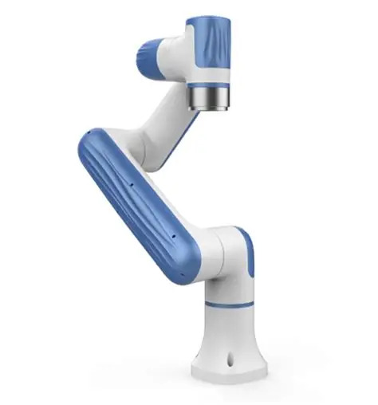

# Dobot Nova2 · Robonix 整机部署

[English](README.en.md) | 简体中文

通过 `rbnx chat` 查询 Nova2 六轴状态、控制 TG-9801 夹爪，以及用 Orbbec 相机完成固定高度的视觉抓取和定点放置。机械臂使用 TCP/IP，夹爪使用主机 USB–RS485，相机使用 Orbbec SDK。运行无需 ROS 2 或 Docker。



## 1. 准备环境

本部署在 Ubuntu 22.04 x86-64 的 WSL2 环境中验证，Robonix 版本为 `1.1.0-beta.1`，机械臂固件为 `3.5.8.5`，使用 Dobot V3 协议。相机和夹爪原语也提供原生 Linux 接入方式。

安装 [Robonix](https://github.com/syswonder/robonix/tree/v1.1.0-beta.1) 和 [uv](https://docs.astral.sh/uv/getting-started/installation/)。已有 Robonix CLI 和源码的用户可先运行下面的环境检查。若需要从源码安装，在 PATH 中已有 Rust、Cargo 和 uv 的环境下执行：

```bash
sudo apt install build-essential pkg-config libssl-dev git curl libasound2-dev
git clone --recursive --branch v1.1.0-beta.1 https://github.com/syswonder/robonix.git
cd robonix
make install
```

确认 `rbnx`、`robonix-codegen` 和系统组件在 PATH 上。若源码路径没有登记，从 Robonix 源码目录运行 `rbnx setup "$PWD"`。

```bash
rbnx --version
rbnx path robonix-api
uv python install 3.11
```

## 2. 连接硬件并填写配置

```bash
git clone https://github.com/syswonder/robot-dobot-nova2.git
cd robot-dobot-nova2
cp .env.example .env
```

在 `.env` 填写 `VLM_BASE_URL`、`VLM_API_KEY` 和 `VLM_MODEL`。URL 使用 OpenAI 兼容的 API 基址，例如 `https://your-model-provider.example/v1`。视觉抓取默认复用这套模型配置，模型须接收图片。模型调用会将当前相机图像发送到所配端点。

按设备实际情况修改 [robonix_manifest.yaml](robonix_manifest.yaml)：

| 实例 | 上线前核对 |
| --- | --- |
| `nova2_arm` | 控制盒启用 TCP/IP 二次开发模式。主机网口配置为同网段，例如 `192.168.5.100/24`，控制器默认 `192.168.5.1`。WSL 中也要能访问控制器。当前使用 V3 的 29999、30003、30004 端口。 |
| `tg9801_gripper` | 核对 USB–RS485 端口、设备地址和波特率。当前为 Modbus RTU、115200、ID 1，WSL 用 `windows_port: COM3`。原生 Linux 将 `windows_port` 设为 `""`，将 `port` 指向实际设备路径，并授予用户串口访问权限。 |
| `orbbec_camera` | 当前为 Gemini 336L、1280×720 MJPG、10 fps。核对 `serial_number`、采集模式和 `expected_camera_key`。只有一个相机时，可将 `serial_number` 留空让 SDK 选取。启动前退出占用相机的标定程序或 Orbbec Viewer。 |
| `nova2_grasp` | 首次在新工位使用时，按下文更新标定、准备位、放置点和夹爪方向。 |

WSL2 下相机直接连接 Windows USB，夹爪连接 Windows COM 口。构建脚本会在 `%LOCALAPPDATA%\Robonix-Nova2-Orbbec` 准备私有 Windows SDK 环境。请确保 WSL 能找到 `powershell.exe`。原生 Linux 下，SDK 在包自己的 Python 环境中运行，按设备安装 Orbbec USB 权限规则。各原语的细项见 [机械臂](primitives/nova2_arm/config.spec)、[夹爪](primitives/tg9801_gripper/config.spec)、[相机](primitives/orbbec_camera/config.spec) 和 [抓取](skills/nova2_grasp/config.spec)。

### 新工位的抓取配置

`config/grasp/` 中的数值来自已调试的工位。换相机、安装位置、工具、桌面高度或机器人后，应重新采集或示教对应的数据：

- [calibration.json](config/grasp/calibration.json) 是 `nova2-planar-handeye-v1` 标定导出，含去畸变图像的 `camera_key`、像素到 User0 XY 的映射、有效多边形、首点抓取高度 `z_mm`。用标定程序重新导出后，将相机配置的 `expected_camera_key` 更新为新导出的值。独立标定程序需在本体停止后使用，完成导出并退出后再启动本体。
- [ready_pose.json](config/grasp/ready_pose.json) 保存示教准备位。使用 User0/Tool0，从同一次机械臂状态读取六轴角和末端位姿，分别填写 `joints_deg` 与 `pose_mm_deg`。准备位的 Z 至少应达到 `z_mm + approach_height_mm`。
- [runtime.json](config/grasp/runtime.json) 保存夹爪闭合轴偏置和确认状态，优先于部署清单。更换或重装夹爪后先将 `confirmed` 设为 `false`。从目标上方核对对齐方向后，再用 `set_jaw_alignment` 保存并确认偏置。
- [place_locations.json](config/grasp/place_locations.json) 的键是地点名。`xy_mm` 是 User0 的 XY，`release_height_mm` 是相对标定 `z_mm` 的释放高度。白盒子示例设为平面上方 150 mm。

需要先做基础控制时，可从部署清单移除 `nova2_grasp` 的 `skill` 段。若还没有相机，可同时移除相机原语和 `soma.yaml` 中的 `camera` 部件。抓取的待夹高度、运动速度及各 JSON 路径在部署清单的 `nova2_grasp.config` 下配置。修改这些配置后重启部署。

## 3. 启动与使用

```bash
./scripts/boot.sh
```

脚本读取本目录的 `.env`，再启动 Atlas、Executor、Soma、Pilot、Liaison 与清单中配置的包。首次启动会构建缺少的包。也可以先执行 `rbnx build -f robonix_manifest.yaml` 检查构建，或在已导出模型变量的终端直接运行 `rbnx boot`。

等待机械臂、夹爪、相机进入 `ACTIVE`。技能按需激活，初始可显示 `INACTIVE`。启动时只建立硬件连接和读取反馈。另开终端运行：

```bash
rbnx caps -v
rbnx tools
rbnx chat
```

可以先用这些语句检查能力和现场状态：

> 查询机械臂、夹爪和相机状态，仅报告反馈。

> 用 `nova2_grasp` 的 `plan_grasp` 规划绿色积木，报告标注图和逆解结果。

确认工位标定和路径后，使用 `approach` 在目标上方核对对齐。视觉技能要求机械臂已使能、静止且夹爪为空。完整操作示例：

> 用 `pick` 抓取绿色积木，原地垂直抬升并保持夹持，再查询 `task_status` 到结束。

> 用 `pick_and_place` 抓取绿色积木并放到白盒子里，`destination="白盒子"`，查询 `task_status` 到结束。

关节指令使用绝对角度（°），末端位姿使用 User0/Tool0 下的 mm/°，四元数使用 `[qx,qy,qz,qw]`。普通 `pick` 停在取物点上方，`pick_and_place` 到配置位置后松爪。`RUNNING` 表示任务已接收，`SUCCEEDED` 表示所需步骤经反馈确认。机械臂运动使用 `motion_status`，抓取任务使用 `task_status`。技能做的是固定平面的 2D 抓取，控制器逆解仅验证端点可达。

详细参数见各提供方手册：[机械臂](primitives/nova2_arm/CAPABILITY.md)、[夹爪](primitives/tg9801_gripper/CAPABILITY.md)、[相机](primitives/orbbec_camera/CAPABILITY.md)、[抓取](skills/nova2_grasp/CAPABILITY.md)。可选 YOLO 后端需要在技能环境安装 `requirements-yolo.txt`，并在清单配置本地 `yolo_model_path` 和可选的类别映射。模型须输出 OBB 有向框。

关闭时按启动终端的 Ctrl+C，或在部署目录执行 `rbnx shutdown`。日志位于 `rbnx-boot/logs/`。

## 4. 排查与验证

- **机械臂反馈超时**：检查控制盒 TCP/IP 模式、主机和 WSL 路由、控制器 IP，以及是否有其他客户端占用控制连接。
- **夹爪无法激活**：检查 COM 号或 Linux 串口权限、RS485 接线、波特率和设备地址。驱动会在启动时校验设备读回的位置和状态。
- **相机无法激活**：检查 USB 是否被占用、当前型号支持的分辨率和帧率，以及标定指纹是否匹配。查看 `primitives/orbbec_camera/rbnx-build/camera-worker.log`。
- **WSL 报 `Exec format error`**：夹爪及相机驱动会尝试 WSL 的 Windows 启动器。若仍失败，检查 Windows 互操作和可执行文件是否可用。

代码与配置的本地验证可在无真机环境运行。构建后执行：

```bash
rbnx validate primitives/nova2_arm
rbnx validate primitives/tg9801_gripper
rbnx validate primitives/orbbec_camera
rbnx validate skills/nova2_grasp
skills/nova2_grasp/rbnx-build/venv/bin/python tests/smoke_grasp.py
```

## 目录结构与许可证

```text
robonix_manifest.yaml  整机清单及目录元数据
soma.yaml, model/      本体描述、URDF 和网格
primitives/            Nova2、TG-9801 和 Orbbec 原语
skills/nova2_grasp/    视觉抓取和定点放置
config/grasp/         工位配置
scripts/, tests/      启动、诊断与回归工具
```

整机和自有代码使用 [MIT](LICENSE)，随附 SDK、网格和串口桥接的来源及单独授权见 [THIRD_PARTY.md](THIRD_PARTY.md)。包结构参考 [Robonix 软件包与部署清单规范](https://book.robonix.ai/integration-guide/packaging-spec)。
